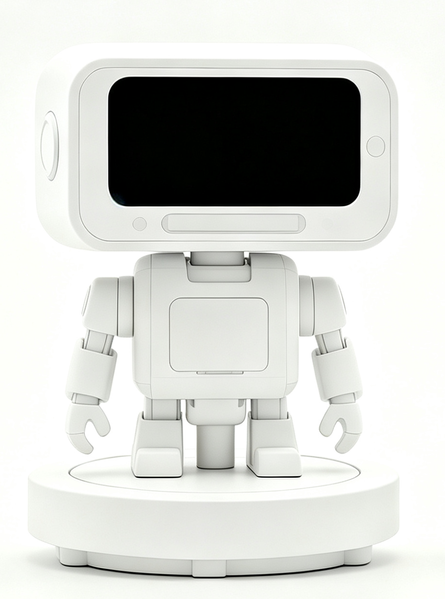
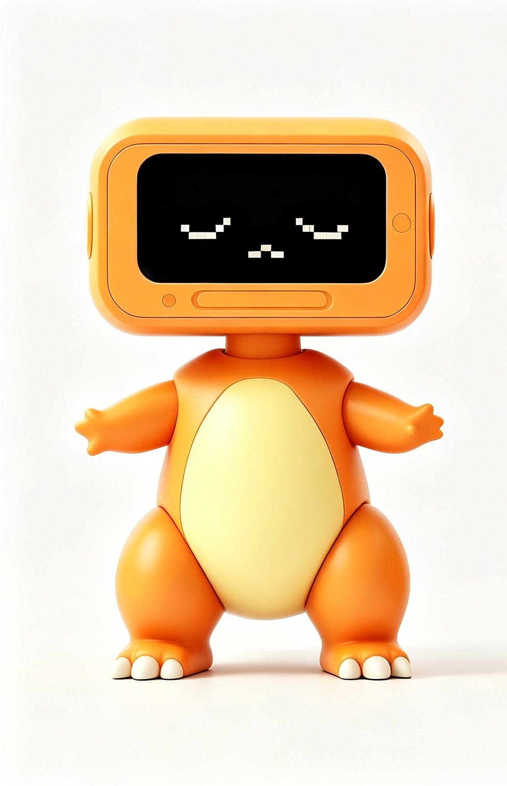
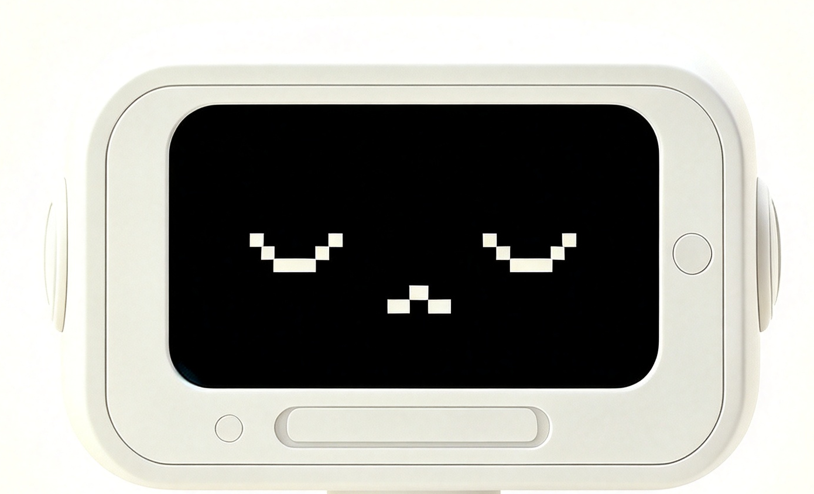

# 伊宝 YiBao · 桌面机器人

> SheNicest 千人黑客松 · **硬件赛道入围奖 · 最佳人气奖**
> 一台能接管电脑的桌面机器人：机身模块化可拆装，云台跟着人脸转。



## 📸 外壳设计迭代

| 三代外壳三视图 | 头部模型统一方案 |
|---|---|
|  |  |

## ✅ 做到什么地步

| 子系统 | 状态 | 说明 |
|---|---|---|
| ESP32-S3 舵机固件 | ✅ 已落地 | 摇杆 / 按键 / 压力 / ICM-20602 / 舵机自检，串口 115200 输出 |
| 云台视觉跟踪 | ✅ 已落地 | YuNet 检测 / SFace 识别 / P 控制跟踪；DirectShow 守护进程 <10 ms 响应 |
| 外壳三维模型 | ✅ 三代迭代 | SolidWorks 一代 / 二代 / 三代外壳，含三视图与 STL 导出件 |
| 官方 SDK 安装包 | ⚠️ 未入库 | 影石官方 SDK 约 2 GB，超 GitHub 单文件限制，需向厂商获取 |
| SolidWorks 源文件 | ⚠️ 未入库 | `model/` 约 1 GB，仅本地保留 |

## 🧩 仓库结构

```
YiBao/
├─ ESP32_other/
│  ├─ esp32s3_servo_ctrl/        ESP-IDF 工程（ESP32-S3-N16R8 硬件自检固件）
│  │  ├─ main/main.c            摇杆/按键/压力/ICM-20602/舵机自检，串口 115200 输出
│  │  ├─ CMakeLists.txt
│  │  └─ build_idf.py, verify_serial.py
│  └─ ESP32_状态报告_2026-08-29.md  本地 IDF 环境与串口/板子状态记录
├─ insta360/开发文件/
│  ├─ win-ptz/                  Insta360 Link 2 云台控制（Windows）
│  │  ├─ link2_studio.py        综合控制平台：Web 控制台 + 云台运动控制 + 录像
│  │  ├─ face_tracker.py        YuNet 检测 / SFace 识别 / P 控制跟踪
│  │  ├─ ptz_server_win.py      云台 HTTP 服务
│  │  ├─ ptz_daemon.c           DirectShow IAMCameraControl 守护进程（<10ms 响应）
│  │  ├─ ptz_dshow.c            DirectShow 云台控制 CLI
│  │  └─ models/                face_detection_yunet.onnx、face_recognition_sface.onnx
│  └─ 交接文档.md                硬件限制、SDK 盘点、环境搭建与落地结论
└─ image/                       外壳渲染图、三视图、STL
```

## 🛠 运行环境

- **固件**：ESP-IDF v5.5.4 + ESP32-S3（USB-UART CH343，COM7，115200）
- **云台程序**：Windows 10/11，Python 3.13（opencv-python-headless ≥ 4.6），FFmpeg（含 dshow），MinGW-w64（编译 C 守护进程）
- **三维模型**：SolidWorks 2024

## 📄 关键文档

- [交接文档：硬件限制与 SDK 选型结论](insta360/开发文件/交接文档.md)
- [ESP32 状态报告](ESP32_other/ESP32_状态报告_2026-08-29.md)

## 🚫 未入库内容（`.gitignore` 排除，仅本地保留）

| 内容 | 体积 | 原因 |
|---|---|---|
| `insta360/赛事SDK包/`、`Link2SDK-拓展协议版/` | ~2 GB（单文件最大 758 MB） | 影石官方 SDK 安装包，超 GitHub 100 MB 单文件限制 |
| `model/` | ~1 GB | SolidWorks 源文件（一代/二代/三代外壳） |
| `build/`、`__pycache__`、`*.exe`、录制与快照 | — | 构建产物与运行期数据 |
